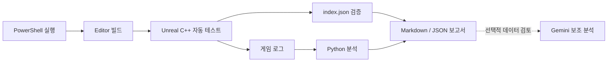

# 게임 테스트 자동화

> Unreal 게임의 **로그 분석 → 동작 검사 → 결함 탐지 → 복원 검증**을 연결하는 QA 자동화 프로젝트입니다.

졸업 작품 **Chicken Fight**를 대상으로 C++ 자동 테스트와 Python 분석 도구를 구현했습니다.
게임을 실행했거나 오류 로그가 없다는 이유만으로 정상이라고 판단하지 않고, 실제 테스트 실행 결과와 관찰 근거를 보고서로 남깁니다.

**검증 결과:** 기본 설정 3개, 게임 동작 3개 통과 → 의도적 결함 주입 시 충돌 검사 1개 실패 → 원본 복원과 재빌드 후 6개 재통과

[자동화 도구 안내](Tools/ChickenQA/README.md) 
[테스트 실행](Tools/ChickenQA/docs/STEP4_UNREAL_AUTOMATION.md)  
[결함 탐지 시연](Tools/ChickenQA/docs/FAULT_DEMO.md)

## 프로젝트 목표

- **실행되지 않은 테스트를 성공으로 처리하지 않기:** 종료 코드와 함께 `index.json`의 테스트 이름, 개수, 상태를 확인합니다.
- **게임 동작을 반복 가능한 조건으로 검사하기:** 실제 캐릭터의 이동 입력, 충돌 응답, 넘어짐 판정을 실행합니다.
- **관찰, 판정, 가설을 구분하기:** 로그 패턴 집계, C++ 테스트 결과, AI 원인 가설을 분리합니다.
- **테스트의 탐지 능력 검증하기:** 구현에 결함을 주입해 실패를 확인하고, 복원 후 다시 통과하는지 검사합니다.

기존 팀 졸업 작품을 대상으로 한 개인 QA 자동화 확장 프로젝트이며, ChatGPT와 Codex를 구현과 분석 보조로 활용했습니다

## 구성과 기술



| 구성 | 역할 |
| --- | --- |
| Unreal C++ / Automation Framework | 기본 설정과 게임 동작의 성공과 실패 판정 |
| PowerShell | Editor 빌드, 테스트 실행, 결과 검사와 분석 연결 |
| Python | 로그 탐색·패턴 집계·마스킹·근거 추출, 결과 보고서 생성 |
| Gemini API | 선택적으로 원인 후보와 추가 검증 방향 제안 |
| JSON / Markdown | 테스트 실행 증거와 사람이 읽는 보고서 보존 |

AI 분석 없이도 빌드, 테스트, 로컬 보고서 생성이 가능합니다. AI 응답은 게임의 통과, 실패를 결정하지 않습니다.

## 자동 테스트 6개

| 구분 | 테스트 | 확인하는 동작 |
| --- | --- | --- |
| 설정 | `ClassRegistered` | 캐릭터 클래스 등록과 기본 객체 |
| 설정 | `MovementComponentReady` | 이동 컴포넌트와 기본 수치 유효성 |
| 설정 | `CapsuleConfigured` | 캡슐 충돌 컴포넌트와 크기 |
| 동작 | `MovementAndInputGate` | 전진 입력 후 실제 위치 변화, 라운드 입력 차단 후 정지 |
| 동작 | `CollisionPushAndCooldown` | 멀어지는 접촉 거절, 접근 시 밀림과 위치 변화, 중복 충격 방지 |
| 동작 | `BalanceFailureGates` | 네 방향 넘어짐, 표시 기울기 조건, 공중·발사 대기 예외, 탈락 후 정지 |

동작 검사는 **임시 월드의 네이티브 캐릭터**를 사용합니다. 
수평 이동은 중력을 분리한 Flying 모드에서 관찰하며, 충돌 접촉 정보와 기울기 경계 상태를 주입한 뒤 실제 게임 구현을 실행합니다. 맵에서의 자연 충돌 검출, 바닥 걷기·자동 홉, Blueprint·애니메이션, 네트워크 복제는 별도 검증 대상입니다.

## 빠른 시작

### 준비

- Windows, Python 3, Unreal Engine 5.8, 해당 엔진의 C++ 빌드 도구가 필요합니다.
- 실제 검증 환경은 **UE 5.8.2 / Development Editor / Win64**입니다.
- 프로젝트 파일은 `ChickenFight.uproject`, Editor 타깃은 `DKUEndGameEditor`입니다.
- 아래 명령은 저장소 루트에서 시작합니다. 기존 `.venv`가 있으면 생성 단계는 생략합니다.

```powershell
$project = (Resolve-Path .\ChickenFight.uproject).Path
Set-Location .\Tools\ChickenQA
python -m venv .venv
```

### 1. 저장된 로그만 분석

```powershell
.\.venv\Scripts\python.exe -m chickenqa --project $project --out output\local
```

이미 존재하는 게임 로그를 읽습니다. 로컬 분석에는 외부 Python 패키지나 AI API 키가 필요하지 않습니다. 
로그가 없다면 게임 실행 후 분석하거나 `--log`로 로그 파일을 지정하세요.

### 2. 빌드 → 테스트 → 보고서

Unreal Editor를 닫고 실행합니다.

```powershell
.\scripts\run_pipeline.ps1 -Project $project -RunTests -BuildEditor
```

`Source/*Editor.Target.cs`에서 타깃을 찾아 빌드하고, `ChickenQA.*` 테스트를 실행합니다. 현재 기본 최소 테스트 수는 6개이며 실패·미실행·결과 누락 시 성공으로 처리하지 않습니다. 엔진 경로가 다르면 `-EngineRoot`를 지정합니다.

```text
Tools/ChickenQA/output/run_<실행시각>/
├── unreal_automation/index.json   # 실제 Unreal 테스트 결과
├── report.md                      # 사람이 읽는 분석 보고서
└── summary.json                   # 분석 결과 데이터
```

로그 패턴으로 탐지한 테스트 건수와 Automation JSON의 실행 수는 별개입니다. 실제 테스트 판정은 보고서의 **Unreal Automation JSON 결과**를 확인하세요.

### 3. 결함 탐지, 복원 시연

```powershell
.\.venv\Scripts\python.exe scripts/run_fault_demo.py --project $project
```

이 명령은 게임 소스의 충격 전달 호출 한 곳을 **임시 변경**하고 정상·결함·복원 단계마다 빌드와 테스트를 실행합니다. 실행 중 Editor와 다른 소스 편집 작업을 중단하세요. 원본 바이트를 백업하고 일반 예외 시 복원을 시도합니다. 강제 종료 시 수동 복원과 재빌드가 필요할 수 있으므로 [복원 안내](Tools/ChickenQA/docs/FAULT_DEMO.md#중단복원)를 확인하세요.

### 4. 선택: Gemini 보조 분석

Gemini 분석을 사용할 때만 `requirements.txt`를 설치하고 API 키를 설정합니다. 먼저 전송할 JSON을 생성·검토한 뒤 해당 파일을 지정해 요청하는 방법은 [AI 분석 안내](Tools/ChickenQA/README.md#2-gemini에-보낼-데이터-먼저-확인-api-호출-없음)를 참고하세요. API 실패 시에도 로컬 결과를 보존합니다.

## 검증 사례 — 충격 전달 누락 탐지

**2026-11-24 / UE 5.8.2 실제 실행 결과**입니다. 실제 게임에서 발견한 버그가 아니라, 기존 테스트의 탐지 능력을 확인하기 위한 의도적 결함 주입 실험입니다.

| 단계 | 성공 | 실패 | 확인 내용 |
| --- | ---: | ---: | --- |
| 정상 기준 | 6 | 0 | 알려진 6개 테스트 모두 실행 |
| `AddImpulse(CollisionImpulse, true)` 임시 제거 | 5 | 1 | 충돌 테스트의 밀림 속도·상대 위치 변화 검사 실패 |
| 원본 복원·재빌드 | 6 | 0 | 전체 재통과, 원본·복원 소스 SHA-256 일치 |

테스트 코드와 통과 기준은 변경하지 않았습니다. 각 단계의 `index.json`, 실행 로그, 분석 보고서와 `evidence.json`을 별도로 보존했습니다. 로컬 증거 폴더는 `Tools/ChickenQA/output/fault_demo_20261124_063218_196811/`이며, 생성 결과는 Git 추적 대상이 아니므로 새로 복제한 저장소에는 포함되지 않습니다. 위 시연 명령으로 새 증거를 생성할 수 있습니다.

## 주요 파일
```text
AI-QA/
├── ChickenFight.uproject
├── Source/DKUEndGame/
│   ├── Character/ChickenCharacter.cpp
│   └── Private/Tests/
│       ├── ChickenQASmokeTests.cpp
│       └── ChickenQAGameplayTests.cpp
├── Tools/ChickenQA/
│   ├── chickenqa/            # 로그·JSON 분석, AI 연동, 보고서
│   ├── scripts/              # 빌드·실행·결함 주입 시연
│   ├── tests/                # Python 도구의 회귀 검사
│   └── docs/                 # 사용법과 검증 범위
└── Docs/                     # 게임 설계·개발 문서
```

## 범위와 다음 단계
- 현재 자동화는 로컬 Editor 실행과 네이티브 동작 검사까지 검증했습니다. CI와 실제 다중 클라이언트 검사는 아직 구성하지 않았습니다.
- 설정 검사 설치기는 기본 3개만 생성합니다. 이 저장소의 추가 동작 검사는 Chicken Fight 구현에 맞춘 코드이며 범용 게임 테스트 도구로 간주하지 않습니다.
- AI 분석의 구현·실패 처리와 게임 테스트 성공은 서로 다른 검증 항목입니다. 위 결함 실험에서는 외부 AI를 호출하지 않았습니다.
- 테스트 수 6개는 게임 전체의 커버리지 비율을 뜻하지 않습니다. 시간 절감률·결함 감소율은 아직 측정하지 않았습니다.
- 다음 확장 대상은 실제 맵의 접촉·착지 검사, 멀티플레이 상태 검증, CI 실행과 시연 영상입니다.

</details>
