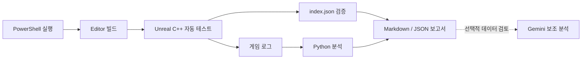
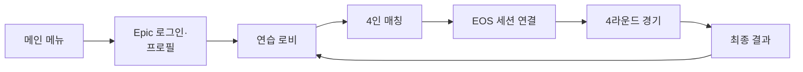
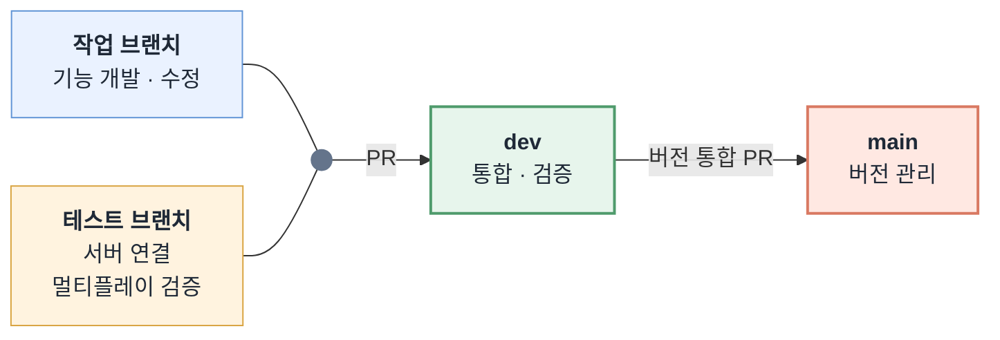

# ChickenQA — AI 보조 게임 테스트 자동화

> Unreal 게임의 **로그 분석 → 동작 검사 → 결함 탐지 → 복원 검증**을 연결하는 QA 자동화 프로젝트입니다.

졸업 작품 **Chicken Fight**를 대상으로 C++ 자동 테스트와 Python 분석 도구를 구현했습니다. 게임을 실행했거나 오류 로그가 없다는 이유만으로 정상이라고 판단하지 않고, 실제 테스트 실행 결과와 관찰 근거를 보고서로 남깁니다.

**검증 결과:** 기본 설정 3개·게임 동작 3개 통과 → 의도적 결함 주입 시 충돌 검사 1개 실패 → 원본 복원·재빌드 후 6개 재통과.

[자동화 도구 안내](Tools/ChickenQA/README.md) · [테스트 실행](Tools/ChickenQA/docs/STEP4_UNREAL_AUTOMATION.md) · [결함 탐지 시연](Tools/ChickenQA/docs/FAULT_DEMO.md) · [포트폴리오](https://app.notion.com/p/41ffed4e19b9807ea26ac678663f48a3)

## 프로젝트 목표

- **실행되지 않은 테스트를 성공으로 처리하지 않기:** 종료 코드와 함께 `index.json`의 테스트 이름·개수·상태를 확인합니다.
- **게임 동작을 반복 가능한 조건으로 검사하기:** 실제 캐릭터의 이동 입력, 충돌 응답, 넘어짐 판정을 실행합니다.
- **관찰·판정·가설을 구분하기:** 로그 패턴 집계, C++ 테스트 결과, AI 원인 가설을 분리합니다.
- **테스트의 탐지 능력 검증하기:** 구현에 결함을 주입해 실패를 확인하고, 복원 후 다시 통과하는지 검사합니다.

기존 팀 졸업 작품을 대상으로 한 개인 QA 자동화 확장 프로젝트이며, ChatGPT·Codex를 구현과 분석 보조로 활용했습니다. 게임 자체의 팀 구성·기여와 기존 자료는 아래 [테스트 대상 게임](#테스트-대상-게임)에 보존합니다.

## 구성과 기술



| 구성 | 역할 |
| --- | --- |
| Unreal C++ / Automation Framework | 기본 설정과 게임 동작의 성공·실패 판정 |
| PowerShell | Editor 빌드, 테스트 실행, 결과 검사와 분석 연결 |
| Python | 로그 탐색·패턴 집계·마스킹·근거 추출, 결과 보고서 생성 |
| Gemini API | 선택적으로 원인 후보와 추가 검증 방향 제안 |
| JSON / Markdown | 테스트 실행 증거와 사람이 읽는 보고서 보존 |

AI 분석 없이도 빌드·테스트·로컬 보고서 생성이 가능합니다. AI 응답은 게임의 통과·실패를 결정하지 않습니다.

## 자동 테스트 6개

| 구분 | 테스트 | 확인하는 동작 |
| --- | --- | --- |
| 설정 | `ClassRegistered` | 캐릭터 클래스 등록과 기본 객체 |
| 설정 | `MovementComponentReady` | 이동 컴포넌트와 기본 수치 유효성 |
| 설정 | `CapsuleConfigured` | 캡슐 충돌 컴포넌트와 크기 |
| 동작 | `MovementAndInputGate` | 전진 입력 후 실제 위치 변화, 라운드 입력 차단 후 정지 |
| 동작 | `CollisionPushAndCooldown` | 멀어지는 접촉 거절, 접근 시 밀림·위치 변화, 중복 충격 방지 |
| 동작 | `BalanceFailureGates` | 네 방향 넘어짐, 표시 기울기 조건, 공중·발사 대기 예외, 탈락 후 정지 |

동작 검사는 **임시 월드의 네이티브 캐릭터**를 사용합니다. 수평 이동은 중력을 분리한 Flying 모드에서 관찰하며, 충돌 접촉 정보와 기울기 경계 상태를 주입한 뒤 실제 게임 구현을 실행합니다. 맵에서의 자연 충돌 검출, 바닥 걷기·자동 홉, Blueprint·애니메이션, 네트워크 복제는 별도 검증 대상입니다.

## 빠른 시작

### 준비

- Windows, Python 3, Unreal Engine 5.8, 해당 엔진의 C++ 빌드 도구가 필요합니다.
- 실제 검증 환경은 **UE 5.8.2 / Development Editor / Win64**입니다.
- 프로젝트 파일은 `ChickenFight.uproject`, Editor 타깃은 `DKUEndGameEditor`입니다.
- 아래 명령은 저장소 루트에서 시작합니다. 기존 `.venv`가 있으면 생성 단계는 생략합니다.

```powershell
$project = (Resolve-Path .\ChickenFight.uproject).Path
Set-Location .\Tools\ChickenQA
python -m venv .venv
```

### 1. 저장된 로그만 분석

```powershell
.\.venv\Scripts\python.exe -m chickenqa --project $project --out output\local
```

이미 존재하는 게임 로그를 읽습니다. 로컬 분석에는 외부 Python 패키지나 AI API 키가 필요하지 않습니다. 로그가 없다면 게임 실행 후 분석하거나 `--log`로 로그 파일을 지정하세요.

### 2. 빌드 → 테스트 → 보고서

Unreal Editor를 닫고 실행합니다.

```powershell
.\scripts\run_pipeline.ps1 -Project $project -RunTests -BuildEditor
```

`Source/*Editor.Target.cs`에서 타깃을 찾아 빌드하고, `ChickenQA.*` 테스트를 실행합니다. 현재 기본 최소 테스트 수는 6개이며 실패·미실행·결과 누락 시 성공으로 처리하지 않습니다. 엔진 경로가 다르면 `-EngineRoot`를 지정합니다.

```text
Tools/ChickenQA/output/run_<실행시각>/
├── unreal_automation/index.json   # 실제 Unreal 테스트 결과
├── report.md                      # 사람이 읽는 분석 보고서
└── summary.json                   # 분석 결과 데이터
```

로그 패턴으로 탐지한 테스트 건수와 Automation JSON의 실행 수는 별개입니다. 실제 테스트 판정은 보고서의 **Unreal Automation JSON 결과**를 확인하세요.

### 3. 결함 탐지·복원 시연

```powershell
.\.venv\Scripts\python.exe scripts/run_fault_demo.py --project $project
```

이 명령은 게임 소스의 충격 전달 호출 한 곳을 **임시 변경**하고 정상·결함·복원 단계마다 빌드와 테스트를 실행합니다. 실행 중 Editor와 다른 소스 편집 작업을 중단하세요. 원본 바이트를 백업하고 일반 예외 시 복원을 시도합니다. 강제 종료 시 수동 복원과 재빌드가 필요할 수 있으므로 [복원 안내](Tools/ChickenQA/docs/FAULT_DEMO.md#중단복원)를 확인하세요.

### 4. 선택: Gemini 보조 분석

Gemini 분석을 사용할 때만 `requirements.txt`를 설치하고 API 키를 설정합니다. 먼저 전송할 JSON을 생성·검토한 뒤 해당 파일을 지정해 요청하는 방법은 [AI 분석 안내](Tools/ChickenQA/README.md#2-gemini에-보낼-데이터-먼저-확인-api-호출-없음)를 참고하세요. API 실패 시에도 로컬 결과를 보존합니다.

## 검증 사례 — 충격 전달 누락 탐지

**2026-11-24 / UE 5.8.2 실제 실행 결과**입니다. 실제 게임에서 발견한 버그가 아니라, 기존 테스트의 탐지 능력을 확인하기 위한 의도적 결함 주입 실험입니다.

| 단계 | 성공 | 실패 | 확인 내용 |
| --- | ---: | ---: | --- |
| 정상 기준 | 6 | 0 | 알려진 6개 테스트 모두 실행 |
| `AddImpulse(CollisionImpulse, true)` 임시 제거 | 5 | 1 | 충돌 테스트의 밀림 속도·상대 위치 변화 검사 실패 |
| 원본 복원·재빌드 | 6 | 0 | 전체 재통과, 원본·복원 소스 SHA-256 일치 |

테스트 코드와 통과 기준은 변경하지 않았습니다. 각 단계의 `index.json`, 실행 로그, 분석 보고서와 `evidence.json`을 별도로 보존했습니다. 로컬 증거 폴더는 `Tools/ChickenQA/output/fault_demo_20261124_063218_196811/`이며, 생성 결과는 Git 추적 대상이 아니므로 새로 복제한 저장소에는 포함되지 않습니다. 위 시연 명령으로 새 증거를 생성할 수 있습니다.

## 주요 파일

```text
AI-QA/
├── ChickenFight.uproject
├── Source/DKUEndGame/
│   ├── Character/ChickenCharacter.cpp
│   └── Private/Tests/
│       ├── ChickenQASmokeTests.cpp
│       └── ChickenQAGameplayTests.cpp
├── Tools/ChickenQA/
│   ├── chickenqa/            # 로그·JSON 분석, AI 연동, 보고서
│   ├── scripts/              # 빌드·실행·결함 주입 시연
│   ├── tests/                # Python 도구의 회귀 검사
│   └── docs/                 # 사용법과 검증 범위
└── Docs/                     # 게임 설계·개발 문서
```

## 범위와 다음 단계

- 현재 자동화는 로컬 Editor 실행과 네이티브 동작 검사까지 검증했습니다. CI와 실제 다중 클라이언트 검사는 아직 구성하지 않았습니다.
- 설정 검사 설치기는 기본 3개만 생성합니다. 이 저장소의 추가 동작 검사는 Chicken Fight 구현에 맞춘 코드이며 범용 게임 테스트 도구로 간주하지 않습니다.
- AI 분석의 구현·실패 처리와 게임 테스트 성공은 서로 다른 검증 항목입니다. 위 결함 실험에서는 외부 AI를 호출하지 않았습니다.
- 테스트 수 6개는 게임 전체의 커버리지 비율을 뜻하지 않습니다. 시간 절감률·결함 감소율은 아직 측정하지 않았습니다.
- 다음 확장 대상은 실제 맵의 접촉·착지 검사, 멀티플레이 상태 검증, CI 실행과 시연 영상입니다.

## 테스트 대상 게임

기존 팀 프로젝트 **Chicken Fight**의 소개·팀원·아키텍처·라이선스·자료를 아래에 보존합니다. 아래 영상은 게임 플레이 영상이며 ChickenQA 자동화 시연 영상은 아닙니다.

<details>
<summary>Chicken Fight 게임 소개와 팀 자료 펼치기</summary>

## CHICKEN FIGHT

> **한 발로 버티고, 상대를 밀어내라!**

전통 놀이 닭싸움을 모티브로 한 **4인 온라인 PvP 파티 브롤러**입니다.<br>
이동과 충전 점프로 상대의 균형을 무너뜨리고, 4라운드 누적 점수로 최종 승자를 결정합니다.

## 시연 영상

<!-- 대표 이미지와 시연 영상 링크를 추가하세요. -->
<a href="https://drive.google.com/file/d/1tKShvgaapBr7XYgLBqbtT7CRoU_LJiuE/view?usp=sharing">
  
</a>

<!--
| 스파링 광장 | 도심 옥상 |
| :---: | :---: |
| 이미지 추가 예정 | 이미지 추가 예정 |

| 댐 정비장 | 놀이동산 |
| :---: | :---: |
| 이미지 추가 예정 | 이미지 추가 예정 |
-->

## 목차

- [게임 개요](#게임-개요)
- [팀원 소개](#팀원-소개)
- [아키텍처 설계](#아키텍처-설계)
- [프로젝트 폴더 구조](#프로젝트-폴더-구조)
- [주요 클래스 구조](#주요-클래스-구조)
- [브랜치 전략](#브랜치-전략)
- [애셋 라이선스 및 저작권](#애셋-라이선스-및-저작권)
- [프로젝트 자료](#프로젝트-자료)

## 게임 개요

### 소개

한 발로 균형을 유지하며 상대와 부딪히는 닭싸움을 온라인 경쟁 게임으로 구현했습니다.<br>
간단한 조작을 기반으로 충돌 방향, 점프 타이밍, 지형 활용에 따라 승부가 달라지는 플레이를 목표로 합니다.

| 항목 | 내용 |
| --- | --- |
| 장르 | 3D · Party Brawler · Online PvP |
| 플랫폼 | Windows PC |
| 플레이 인원 | 4인 |
| 경기 방식 | 개인전 · 4라운드 · 누적 점수 |
| 개발 기간 | 2026.09 ~ 2026.11 |

### 주요 특징

- **균형과 충돌 중심의 전투:** 이동·충전 점프로 상대를 밀고, 반대 방향 입력으로 균형 회복
- **4라운드 누적 경쟁:** 생존 순위에 따라 점수를 획득하고 최종 순위 결정
- **서로 다른 전투 공간:** 평면 광장, 수직 옥상, 장애물 전투장, 시소 무대
- **인터랙티브 로비:** 매칭 대기 중 캐릭터 조작과 점프 연습
- **온라인 플레이:** Epic 로그인, 닉네임 설정, 4인 매칭 및 EOS 세션 연결

### 핵심 시스템

| 시스템 | 주요 기능 |
| --- | --- |
| 캐릭터 조작 | WASD 이동·기울기 조절, 자동 제자리 점프, 충전 점프 |
| 충돌·균형 | 충돌에 따른 밀림과 기울기 변화, 균형 회복, 넘어짐·탈락 |
| 경기 진행 | 맵 4개를 무작위 순서로 중복 없이 진행, 생존 순위 판정, 점수 집계, 최종 결과 |
| 맵·장애물 | 이동 발판, 회전 장애물, 통나무, 물줄기, 시소 전투판 |
| 플레이 피드백 | 플레이어 식별, 점프 충전 게이지, 균형 위험 효과·방향 화살표 |

라운드 점수는 **1위 5점 / 2위 3점 / 3위 1점 / 4위 0점**입니다.<br>
결과표는 누적 점수순으로 표시하며, 현재 구현에서는 동점 시 공동 순위로 처리합니다.

### 개발 환경

| 구분 | 기술·도구 |
| --- | --- |
| 게임 엔진 | Unreal Engine 5.8 |
| 클라이언트 | C++ · Blueprint |
| UI | UMG · Widget Blueprint |
| 온라인 서비스 | Epic Online Services |
| 백엔드 | AWS 기반 인증·프로필·매칭 API |
| 버전 관리 | Git · GitHub |
| 기획·협업 | Notion · Figma · FigJam · GitHub Projects |

### 프로젝트 실행

- 프로젝트 파일: `ChickenFight.uproject`
- Editor 빌드 타깃: `DKUEndGameEditor`
- Runtime 모듈: `DKUEndGame`
- 시작 맵: `/Game/Frontend/Lvl_CF_MainMenu`

온라인 기능 실행에는 별도의 EOS 로컬 설정이 필요합니다.

- [로그인·로컬 설정 안내](Docs/Network/LoginEntry.md)
- [EOS 연결·테스트 안내](Docs/Network/EOSRound1Session.md)

## 팀원 소개

<!-- 실제 담당과 GitHub 링크를 작성하세요. 행은 팀 구성에 맞게 추가·삭제하세요. -->

| 팀원 | 담당 | 주요 기여 | GitHub |
| --- | --- | --- | --- |
| 안지성 | PM · 게임 기획 · 레벨 디자인 · UX/UI | 핵심 조작·전투·점수 규칙 설계, 맵 4종과 연습 로비 제작,<br>UX/UI 설계·구현, 개발 우선순위·일정 및 협업 관리 | [](https://github.com/j1sung) |
| 김호영 | 클라이언트 · 서버 | 캐릭터 조작·전투 시스템, Unreal 리슨 서버 로직 및 멀티플레이 동기화 | [](https://github.com/sunsi-game) |
| 정규민 | 클라이언트 · 서버 | Unreal 리슨 서버 로직 및 멀티플레이 동기화 | [](https://github.com/KyuminChung) |
| 김은재 | 백엔드 · 네트워크 | 외부 인증·프로필·매칭 API, AWS 인프라 구축·배포 및 운영 | [](https://github.com/Developer-EJ) |

## 아키텍처 설계

### 온라인 경기 흐름



### 역할 분리

| 계층 | 역할 |
| --- | --- |
| UI | 사용자 입력, 접속·매칭 상태, 경기 정보 표시 |
| GameInstance Subsystem | 인증·매칭·세션 처리, 맵 간 경기 정보 유지 |
| GameMode | 서버의 경기 시작, 탈락 판정, 라운드 진행·점수 집계 |
| GameState·PlayerState | 경기 상태와 플레이어 정보를 클라이언트에 복제 |
| Character·Component | 캐릭터 조작, 충돌·균형 처리, 플레이어 표시 |
| Blueprint·레벨 | 에셋 연결, 기믹 구성, 배치·수치 조정 |

클라이언트의 입력과 UI 요청을 서버의 경기 상태·판정과 구분합니다.<br>
맵 전환 시 유지해야 하는 경기 정보는 GameInstance 수명의 Subsystem에서 관리합니다.

상세 설계는 [게임플레이](Docs/Gameplay/Overview.md), [네트워크](Docs/Network/Overview.md), [UI](Docs/UI/Overview.md) 문서를 참고하세요.

## 프로젝트 폴더 구조

주요 폴더를 발췌한 구조입니다.

```text
📂 ChickenFight
├── 📄 ChickenFight.uproject
├── 📂 Config                 # 프로젝트·입력·온라인 설정
├── 📂 Content
│   ├── 📂 Frontend           # 메인메뉴·기존 LAN 아레나 맵
│   ├── 📂 Map                # 연습 로비·라운드 맵
│   ├── 📂 Characters         # 캐릭터·애니메이션
│   ├── 📂 Input              # 입력 액션·매핑
│   ├── 📂 UI                 # 위젯·폰트·UI 리소스
│   └── 📂 LD_Gym             # 레벨 에셋·장애물
├── 📂 Source
│   └── 📂 DKUEndGame
│       ├── 📂 Character      # 캐릭터·균형·표시
│       ├── 📂 Gameplay       # 게임플레이 기믹
│       ├── 📂 Network        # 인증·매칭·세션·경기 진행
│       ├── 📂 UI             # UI 동작
│       ├── 📂 Testing        # 테스트용 액터·게임모드
│       └── 📂 Tests          # 자동화 테스트
├── 📂 Backend-Infra          # 백엔드·인프라
├── 📂 Tools                  # 에디터·네트워크 개발 도구
└── 📂 Docs                   # 설계·설정·개발 문서
```

## 주요 클래스 구조

| 영역 | 주요 클래스 | 책임 |
| --- | --- | --- |
| 캐릭터 | `AChickenCharacter` | 이동·점프·충돌·균형·넘어짐 |
| 플레이어 표시 | `UCFPlayerPresentationComponent` | 이름표·점프 게이지·위험 HUD |
| 메뉴 상태 | `UCFFrontendSubsystem` | 타이틀·로그인·닉네임 UI 상태 관리 |
| 인증·프로필 | `UCFEntrySubsystem` | 로그인·프로필 요청·로비 진입 |
| 매칭 | `UCFMatchmakingSubsystem` | 매칭 티켓 요청·조회·취소 |
| 세션 연결 | `UCFMatchSessionSubsystem` | EOS 세션 생성·검색·참가 |
| 경기 규칙 | `ACFRoundGameMode` · `ACFWaitingGameMode` | 경기 시작·탈락·라운드·점수 관리 |
| 경기 상태 | `ACFWaitingGameState` | 경기 단계·생존자·점수 복제 |
| 맵 간 정보 | `UCFMatchRuntimeSubsystem` | 맵 순서·플레이어 식별·점수 유지 |

C++은 주요 로직과 네트워크 상태를 처리하며,
Blueprint는 레벨·기믹 구성과 에셋 연결, 조정 가능한 설정에 사용합니다.<br>
UI는 C++ 위젯과 Widget Blueprint를 함께 사용합니다.

## 브랜치 전략

기능 개발과 테스트 작업을 별도 브랜치에서 진행하고, 검증한 변경사항을 `dev`에 통합합니다.



| 브랜치 | 용도 |
| --- | --- |
| 작업 브랜치 | 기능 개발·수정 |
| 테스트 브랜치 | 서버 연결·멀티플레이 등 테스트와 관련 수정 |
| `dev` | 개발·테스트 결과 통합 및 검증 |
| `main` | 버전 단위 통합 |

- 기능 개발은 작업 브랜치에서 진행하고 PR을 통해 `dev`에 반영합니다.
- 서버 연결·멀티플레이 검증 등은 별도 테스트 브랜치에서 진행하고, 필요한 수정사항을 PR로 `dev`에 반영합니다.
- 버전 통합 시 `dev`에서 `main`으로 PR을 생성합니다.
- PR에는 변경 내용과 검증 결과를 작성합니다.
- 구현·설정 변경에 필요한 문서는 코드와 함께 관리합니다.

## 애셋 라이선스 및 저작권

외부 리소스는 각 제작자가 지정한 라이선스를 따릅니다.

<!-- 사용한 외부 리소스의 출처와 라이선스를 확인해 작성하세요. -->

| 구분 | 리소스 | 출처 | 라이선스·비고 |
| --- | --- | --- | --- |
| 폰트 | Inter | [Inter](https://rsms.me/inter/) | [라이선스 원문](Content/UI/MainMenu/Fonts/Inter-LICENSE.txt) |
| 3D 애셋 | 배경·오브젝트 | GPT·Codex를 활용하여 Unreal Engine에서 자체 제작 | 프로젝트 제작 리소스 |
| 애니메이션 | 캐릭터 동작 | GPT·Codex를 활용하여 Unreal Engine에서 자체 제작 | 프로젝트 제작 리소스 |
| 음원·효과음 | 배경음·동작 효과음 | GPT·Codex를 활용한 자체 제작 | 프로젝트 제작 리소스 |

<!-- 프로젝트 코드의 라이선스는 팀 합의 후 별도로 명시하세요. -->

## 프로젝트 자료

- 📄 [프로젝트 결과 보고서](https://docs.google.com/document/d/1sYPFTVFm0Dg2Fjk_jDDc7KS09rd3cR_Wt3WgujIIvI4/edit?tab=t.0)
- 📚 [개발 문서 목차](Docs/index.md)

### 프로젝트 포스터
<!-- 완성된 포스터 이미지를 여기에 추가 -->


</details>
